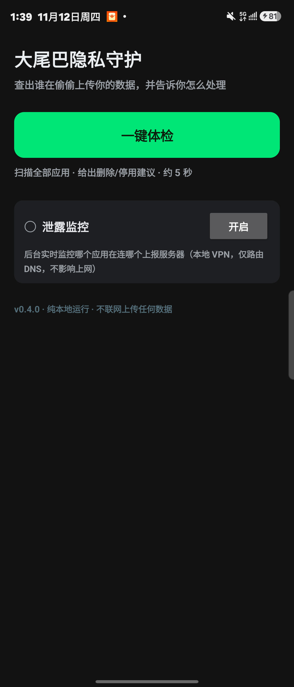
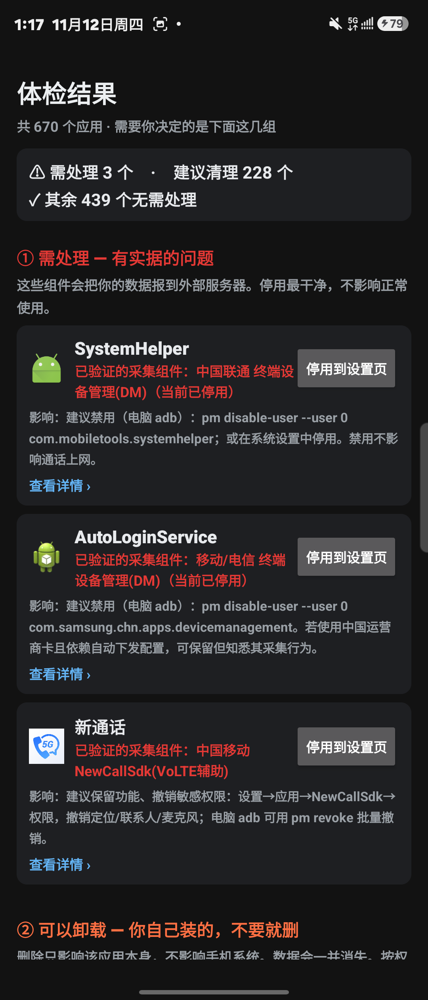

# 大尾巴隐私守护 · Daweiba Privacy Guard

> **面向中文用户的安卓隐私审计工具**，文档以中文为主 · [English summary ↓](#english)

<p align="center">
  
</p>

<p align="center">
  <b>查出谁在偷偷上传你的数据，并告诉你怎么处理。</b><br>
  <sub>Find out which apps are leaking your data — and what to do about it.</sub>
</p>

<p align="center">
  
  
  
  
  
</p>

---

## 这是什么

一个**纯本地运行**的安卓隐私审计工具。它回答两个问题：

1. **哪些应用可能把你的数据传到别处？**
2. **我该怎么处理？删掉有风险吗？**

它不靠"申请了多少权限"这种粗糙打分。判断依据是：签名库命中（已知的数据采集 SDK）、实时 DNS 泄露监控（真的看到它在连上报域名）、以及最小权限基线。

扫完给你**四类结论**，每一条都写清影响：

| 结论 | 含义 |
|---|---|
| 🔴 需要处理 | 已确认在向第三方上报数据，建议关闭相关服务 |
| 🟠 可以卸载 | 用户自装应用，风险高且无明显用途 |
| 🟡 可以停用 | 预装应用，停用后系统仍正常，已注明副作用 |
| ⚪ 建议保留 | 系统核心组件，动它会出问题 |

<p align="center">
  
  &nbsp;&nbsp;&nbsp;
  
</p>

---

## 功能

- **一键体检** —— 扫描全部已安装应用，约 5 秒出结论
- **泄露监控** —— 本地 `VpnService` 只路由 DNS，实时看到哪个应用在连哪个上报域名，可一键拦截（返回 NXDOMAIN）
- **处理建议引擎** —— 预装应用逐条规则 + 用户应用优先判卸载，每条附停用影响说明
- **一键停用 / 一键恢复** —— 装了 Shizuku 并授权后，可直接在结论页停用预装应用，随时一键恢复（详见下方「可选增强」）
- **一键跳转处置** —— 没有 Shizuku 时，按钮自动退回「去停用」，打开系统应用详情页手动操作
- **可疑外联（启发式，自动）** —— 不依赖已知域名：按域名关键词、心跳式重复解析、域名数量、凌晨后台活动，标出「可疑（未确认）」的应用；需先开启泄露监控
- **深度扫描（可选，手动）** —— 离线抽样读取系统预装应用的安装包，查找内置的上报域名与遥测关键词；全程本地、不联网
- **OTA 复查提醒** —— 本地记录系统版本指纹，检测到系统更新后提醒你重新体检（全程不联网）
- **知识库更新（可选）** —— 默认零联网；只有你主动填入 HTTPS 地址并点检查时，才下载一份域名清单，可随时清除
- **默认零联网、零追踪** —— 没有服务器，没有账号，没有统计 / 广告 / 崩溃上报 SDK

---

## 能发现哪些「新的」遥测

内置的 13 条上报域名和 8 条组件签名只能覆盖**已经知道**的东西。自 v0.7.0 起，增加了两条不依赖白名单的路径：

| 路径 | 依据 | 边界 |
|---|---|---|
| 可疑外联（每次体检自动跑） | 域名关键词、心跳式重复解析、解析的不同域名数量、凌晨 0–6 点后台活动 | 需先开启「泄露监控」才有输入；结论是**「可疑（未确认）」**，不是已确认泄露 |
| 深度扫描（首页手动触发） | 抽样读取系统预装应用安装包里的 URL / 域名字符串 | 只代表「包里写了这个地址」，不代表它正在上报；为控制耗时只抽样 30 个应用 |

**仍然看不到**：硬编码 IP 直连（不走 DNS）、DoH / DoT 加密 DNS、域名看起来正常但内容在传数据的连接、只在本地采集不联网的组件。要覆盖这些需要接管全部流量或 root，会破坏本应用「只路由 DNS、不影响上网、纯本地」的定位。

---

## 可选增强：直接从 App 端停用

普通安卓应用**没有权限停用别的应用**——`CHANGE_COMPONENT_ENABLED_STATE` 是 `signature|privileged` 权限，第三方 App 拿不到。所以 v0.6.0 把 [Shizuku](https://shizuku.rikka.app/) 做成**可选增强**，而不是运行前提：

| 状态 | 结论页按钮 | 效果 |
|---|---|---|
| 没装 Shizuku | 「去停用」 | 跳系统应用详情页，手动停用（与旧版相同） |
| 装了但没授权 | 状态条提示点一下授权 | 授权后按钮自动升级 |
| 已授权 | 「一键停用」 | 直接执行 `pm disable-user --user 0 <pkg>` |

授权后出现「恢复 N 个」按钮，可批量 `pm enable` 撤回。所有停用都记在本地，随时可撤销。

**启用方式**（Android 11+ 不需要电脑）：
1. 安装 Shizuku，在「开发者选项 → 无线调试」里配对启动
2. 打开本 App 做完体检，在结论页顶部状态条点一次授权
3. 之后按钮变为「一键停用」，停用前会弹二次确认并显示影响说明

**安全兜底**：
- 系统核心、启动器、GMS、**本 App 自身**、Shizuku 自身均列入禁止停用名单（停了自己就再也恢复不了）
- 包名做 `^[A-Za-z0-9_.]+$` 校验，防止命令注入
- 只执行固定的 `pm disable-user` / `pm enable` 两条命令，不接受任意输入

> Android 16 上 Shizuku 可能需要在应用信息里开「允许受限设置」、关闭电池优化；部分 Beta 还需在开发者选项打开「停用子进程限制」。

> **上架提示**：Google Play 对 Shizuku 类能力审核更严（会被安全扫描标记为 sandbox bypass）。走 GitHub Releases / F-Droid 不受影响。

---

## 隐私

**本应用默认不联网、不注册、不上传任何数据。**

- 无广告 SDK、无统计 SDK、无崩溃上报
- 默认网络行为：开启泄露监控时，把设备内其他应用的 DNS 查询转发到**你当前网络自带的 DNS 服务器**（Android VPN 机制要求，否则手机会断网）
- 可选网络行为：只有你在首页填入 `https://` 地址并点「检查更新」，才会向该地址发一次 GET 下载域名清单；请求不携带任何设备 / 应用 / DNS 信息
- 不记录访问历史、不写日志到磁盘、不用远程 DNS

完整说明见 **[PRIVACY.md](PRIVACY.md)**，在线版：
<https://qikuanhe.github.io/daweiba-privacy-guard/privacy_policy.html>

---

## 安装

### 方式一：下载 APK

从 [Releases](../../releases) 下载最新的 `DaweibaPrivacy-v*.apk`，直接安装。

> 需要 Android 8.0（API 26）及以上。
> 安装时系统可能提示"未知来源"，需在设置中允许你的浏览器或文件管理器安装应用。

### 方式二：用 Obtainium 自动更新

[Obtainium](https://github.com/ImranR98/Obtainium) 可以监控本仓库的 Releases 并自动提示更新。

### 方式三：从源码构建

不需要 Android Studio，也不需要 Gradle。见下方「构建」。

---

## 构建

不需要 Android Studio，也不需要 Gradle。依赖：

- JDK 17
- Kotlin 编译器（`kotlinc`）
- Android SDK Build-Tools 35 + Platform 35
- Python 3（`pack.py` 注入 dex 用）
- `libs/` 下 4 个 Shizuku jar（来自 Maven Central `dev.rikka.shizuku:{api,aidl,provider,shared}:13.1.5`，已随仓库提供）

工具链目录约定（三者同级）：

```text
tools/
├── jdk17/
├── kotlinc/
└── sdk/
    ├── build-tools/35.0.0/
    └── platforms/android-35/
```

把该目录通过环境变量指给脚本：

```bash
export ANDROID_TOOLS_DIR=/path/to/tools
# 可选：单独覆盖某个工具
# export JDK_HOME=/path/to/jdk17
# export KOTLIN_HOME=/path/to/kotlinc
# export ANDROID_SDK_ROOT=/path/to/sdk
# export PYTHON_BIN=/path/to/python

bash build.sh
# 产物：DaweibaPrivacy-v0.7.1.apk
```

> 脚本面向 **Windows + Git Bash**（`aapt2.exe` / `d8.bat` / `apksigner.bat` 均为 Windows 版）。
> 首次构建会在 `.keystore/` 自动生成签名文件（已加入 `.gitignore`），请自行备份；换签名后无法覆盖安装旧版本。
> 未设置 `ANDROID_TOOLS_DIR` 时，脚本会依次尝试 `./tools` 与 `../android_tools`。

构建流程（`build.sh` 内 6 步）：

```
aapt2 compile → aapt2 link → kotlinc → d8 → 注入 classes.dex → zipalign + apksigner
```

版本号、包名路径、输出文件名都集中在 `build.sh` 顶部：

```bash
PKG_PATH="com/daweiba/privacyguard"
VERSION_CODE=12
VERSION_NAME=0.7.1
APK="DaweibaPrivacy-v${VERSION_NAME}.apk"
```

---

## 权限说明

| 权限 | 用途 |
|---|---|
| `QUERY_ALL_PACKAGES` | 扫描全部已安装应用（核心功能） |
| `INTERNET` | 仅转发 DNS 查询到本网络的 DNS 服务器 |
| `FOREGROUND_SERVICE` / `..._SPECIAL_USE` | 泄露监控后台常驻 + 通知 |
| `POST_NOTIFICATIONS` | 显示监控运行通知 |
| `BIND_VPN_SERVICE` | 建立本地 DNS 监控通道 |
| `moe.shizuku.manager.permission.API_V23` | 可选：向 Shizuku 申请 shell 身份，用于一键停用 / 恢复 |

**不申请**：位置、通讯录、短信、通话记录、相机、麦克风、存储读写、无障碍。

---

## 免责声明

- 本应用是**信息工具**，不是杀毒软件，不能保证检出所有数据上报行为。
- 域名知识库基于公开信息与实测整理，可能存在遗漏或误判。
- **停用系统应用有风险**。应用内已标注每个预装组件的停用影响，请阅读后再操作。因自行停用系统组件导致的设备异常需自行承担。
- 卸载应用前请确认没有依赖它的自动化流程。

---

## 贡献

域名库、签名库、预装应用规则都在独立文件里，补充起来很容易：

- `DomainKb.kt` —— 上报域名库
- `SignatureDb.kt` —— 已知采集 SDK 签名
- `AdviceDb.kt` —— 预装应用处置规则
- `Heuristics.kt` —— 可疑外联启发式规则（关键词 / 白名单 / 判定阈值）
- `ApkScanner.kt` —— 离线包内线索扫描（抽样数量、时间预算、域名正则）

也可以不提 PR：把下面格式的文件托管在任意 HTTPS 地址，在 App 首页填地址点「检查更新」即可合并进本地知识库：

```json
{
  "version": "2026-11-19",
  "domains": [
    {"domain": "example-telemetry.com", "title": "示例上报域名", "note": "依据说明"}
  ]
}
```

欢迎提 PR，请附上判定依据（抓包记录、域名解析结果、官方文档链接）。

---

## 更新日志

各版本改动见 [CHANGELOG.md](CHANGELOG.md)。

---

## License

[GPL-3.0-or-later](LICENSE)

---

## English

**Daweiba Privacy Guard** is a local-first Android privacy auditor.

- Scans every installed app, flags those that ship known telemetry SDKs or contact known reporting domains
- Local `VpnService` monitors DNS queries in real time (DNS-only routing, optional blocking)
- Returns an actionable verdict per app — **fix / uninstall / disable / keep** — each with its side effects spelled out
- Optional **Shizuku** enhancement unlocks one-tap disable / one-tap restore for preinstalled apps; without it, buttons fall back to opening system settings
- **OTA re-check reminder** (local build-fingerprint comparison) and optional manual knowledge-base updates
- **Heuristic suspicious-outbound detection** — flags unconfirmed anomalies without needing a known domain (keyword segments, heartbeat-like repeats, domain count, night-time activity)
- Optional **deep scan** — offline sampling of preinstalled APKs for embedded reporting endpoints
- Offline by default: no server, no account, no analytics, no ads. A network request happens only if you explicitly enter an HTTPS URL and tap "Check for updates"

Requires Android 8.0+. Install from [Releases](../../releases) or build with `bash build.sh` (JDK 17 + Kotlin + Build-Tools 35, no Gradle needed).

Read [PRIVACY.md](PRIVACY.md) for the full data-handling statement.

> This is an informational tool, not an antivirus. Disabling preinstalled system components carries risk — read the impact note before acting.
